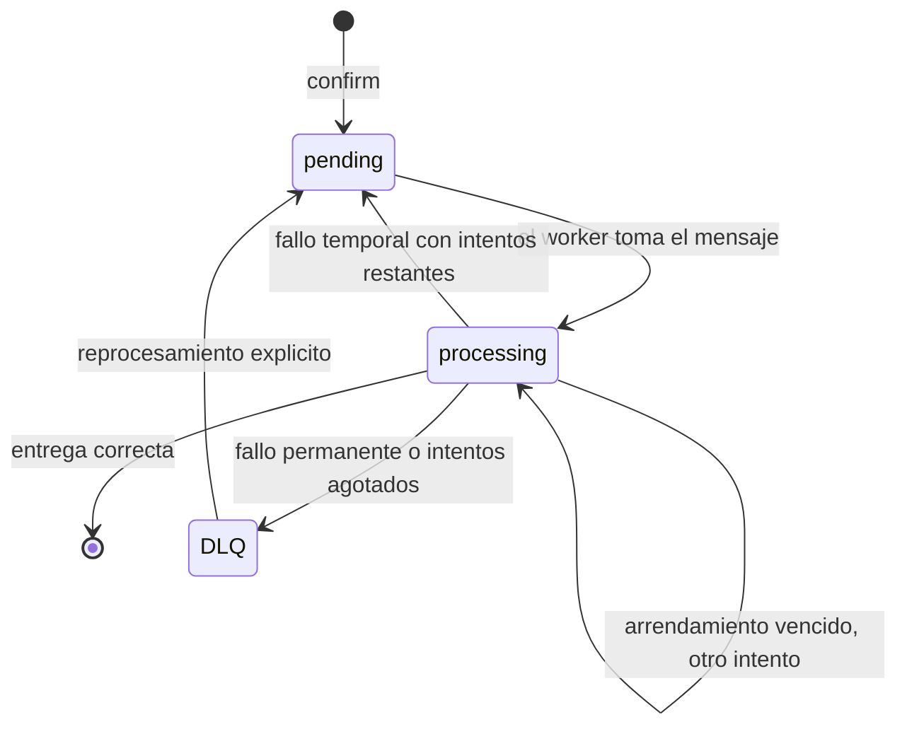

# Adicional 2: cola de notificaciones, worker y DLQ

Rama: `adicional-2-cola-dlq`, a partir de la etiqueta `estado-final` de `main`. Es independiente del adicional 1.

## Alcance y garantias

- **Un unico worker.** Esta version no coordina varios workers sobre la misma cola. Procesa un mensaje a la vez.
- **Entrega al menos una vez, efecto local sin duplicados.** No se promete entrega exactamente una vez. Cada mensaje lleva una clave de deduplicacion (`pedido-confirmado-<id del pedido>`) y el worker registra la notificacion y confirma el mensaje en una sola transaccion. Si el mismo mensaje llega dos veces, la segunda se descarta sin repetir el efecto.
- **El canal sigue siendo local.** La "notificacion" es un registro en la tabla `notifications`; no se envian correos reales. El canal simulado permite provocar fallos de forma reproducible.
- **Un canal real** podria recibir un mensaje dos veces si el worker se interrumpe justo entre la entrega y la confirmacion; por eso la deduplicacion se hace por clave y no se confia en que el canal sea exactamente una vez.

## Cambio de comportamiento respecto de la base

`confirm` ya no escribe en `notifications`: deja un mensaje `pending` en `notification_queue`, dentro de la misma transaccion que descuenta el stock y cambia el estado. Si falta stock en cualquier linea, el rollback tambien descarta el mensaje, como antes descartaba la notificacion. `GET /orders/{id}/notifications` lista las notificaciones ya entregadas por el worker, de modo que aparecen despues de que este corra.

Por ese contrato nuevo se ajustaron tres pruebas base. Ninguna regla de negocio cambia (precios, stock, estados ni la transaccion de confirmacion):

| Prueba | Ajuste |
| --- | --- |
| `tests/test_orders.py::test_confirmation_keeps_price_and_deducts_stock_once` | Comprueba que no hay notificaciones antes del worker, ejecuta el worker y entonces espera una |
| `tests/test_order_states.py::test_final_orders_reject_changes` | Ejecuta el worker antes de leer las notificaciones |
| `tests/test_orders_api.py::test_confirmation_registers_the_notification_for_the_customer` | Igual que la primera |

## Flujo de un mensaje



## Parametros

| Parametro | Valor | Donde |
| --- | --- | --- |
| Intentos maximos | 3, contando el primero | `MAX_ATTEMPTS` en `app/worker.py` |
| Espera antes del reintento | 5 s tras el primer fallo y 10 s tras el segundo (`5 s * 2^(intento - 1)`) | `RETRY_DELAY_SECONDS` |
| Arrendamiento de un mensaje en procesamiento | 30 s | `LEASE_SECONDS` |
| Consulta de la cola | cada 1 s | `POLL_SECONDS`, opcion `--poll` |

## Modelo de datos

| Tabla | Contenido |
| --- | --- |
| `notification_queue` | Mensajes `pending` o `processing`: clave de deduplicacion, pedido, destinatario, texto, intentos, `available_at`, `locked_until`, ultimo error. El `id` usa `AUTOINCREMENT` para que un identificador nunca se reutilice |
| `notification_dlq` | Mensajes que agotaron sus intentos o fallaron de forma permanente, con contenido, intentos y causa del ultimo error. Conserva el `id` original |
| `delivered_messages` | Clave de deduplicacion de cada mensaje entregado y la notificacion que produjo |
| `notifications` | Sin cambios: el efecto visible, consultable por pedido |

## Simulacion de fallos

El canal simulado decide segun el destinatario y el numero de intento guardado en SQLite, sin azar ni dependencia del reloj, por lo que el resultado se repite igual incluso despues de reiniciar. Se configura con `LAB_NOTIFY_SIMULATION`:

```
LAB_NOTIFY_SIMULATION=ana@example.com=temporary:2,luis@example.com=permanent
```

- `temporary:N`: el destinatario falla de forma temporal en sus primeros N intentos y despues recibe.
- `permanent`: falla siempre. No se reintenta: el mensaje pasa directo a la DLQ.
- Cualquier otro error del canal se trata como temporal. Las pruebas tambien inyectan el plan o un canal propio.

## Reintentos, DLQ y reprocesamiento

- Un fallo temporal devuelve el mensaje a `pending` con `available_at = ahora + espera` y guarda el error.
- Al agotar los intentos, o ante un fallo permanente, el mensaje se mueve a `notification_dlq` en una transaccion, con su contenido, el numero de intentos y la causa del ultimo error.
- `POST /notifications/dlq/{id}/reprocess` lo devuelve a la cola con intentos en cero y el mismo `id`. Es una accion explicita; nada se reprocesa solo.

## Interrupciones y reinicios

- Todo vive en SQLite: los pendientes y la DLQ sobreviven a reinicios de la API y del worker.
- Tomar un mensaje cuenta como un intento y le da un arrendamiento de 30 s. Si el worker muere, al vencer el arrendamiento otro intento lo retoma.
- Un mensaje que siempre interrumpe al worker consume sus intentos y termina en la DLQ con la causa "Procesamiento interrumpido", en lugar de reintentarse sin fin.

## API

| Operacion | Descripcion |
| --- | --- |
| `GET /notifications/queue` | Mensajes pendientes y en procesamiento |
| `GET /notifications/dlq` | Mensajes en la DLQ, con intentos y ultimo error |
| `POST /notifications/dlq/{id}/reprocess` | Devuelve un mensaje de la DLQ a la cola; `404` si no esta en la DLQ |

## Criterios y pruebas

Todas en `tests/test_notification_queue.py`:

| Criterio | Prueba |
| --- | --- |
| Confirmar deja un pendiente y el worker lo procesa aparte | `test_confirmation_leaves_a_pending_notification_until_the_worker_runs`, `test_failed_confirmation_enqueues_nothing`, `test_repeated_confirmation_enqueues_a_single_message` |
| Fallos temporales o permanentes con simulacion reproducible | `test_simulation_plan_is_parsed_from_text`, `test_invalid_simulation_rule_is_rejected`, `test_simulated_channel_is_deterministic`, `test_main_uses_the_failure_simulation_from_the_environment` |
| Reintentos con maximo y espera documentados | `test_temporary_failure_is_retried_after_a_wait`, `test_unexpected_channel_error_is_retried`, `test_documented_defaults` |
| La DLQ conserva contenido, intentos y causa | `test_exhausted_attempts_move_the_message_to_the_dlq`, `test_permanent_failure_goes_straight_to_the_dlq` |
| Consultar la DLQ y reprocesar | `test_dlq_message_can_be_reprocessed_explicitly`, `test_reprocessing_an_unknown_message_returns_404`, `test_message_ids_are_never_reused_so_reprocessing_cannot_collide` |
| Sobrevive a reinicios y recupera un mensaje en procesamiento | `test_pending_messages_survive_a_restart`, `test_interrupted_message_is_recovered_after_the_lease_expires`, `test_message_that_keeps_interrupting_the_worker_ends_in_the_dlq` |
| Un duplicado no duplica el efecto | `test_duplicate_messages_do_not_duplicate_the_notification`, `test_completing_an_already_delivered_message_has_no_second_effect` |
| Ejecucion del worker | `test_run_forever_processes_messages_until_stopped`, `test_main_once_processes_the_queue_and_exits`, `test_main_without_once_runs_until_interrupted` |

## Limitaciones

- Un solo worker; con varios habria que revisar el arrendamiento y el orden de procesamiento.
- La espera y los intentos son constantes del codigo, no configuracion externa.
- Los arrendamientos y las esperas dependen del reloj del sistema.
- Los mensajes entregados se eliminan de la cola; el historial queda en `notifications` y `delivered_messages`.
- La DLQ crece hasta que alguien la reprocese; no hay limpieza ni autenticacion en sus rutas.
- Reprocesar reinicia el presupuesto de intentos, aunque la causa del fallo siga presente.

## Como probarlo

1. Terminal 1, con una base propia para la demostracion:

```powershell
$env:LAB_DB_PATH = "data/demo_cola.sqlite3"
uv run main.py
```

2. En Swagger crea un cliente `ana@example.com`, un producto y un pedido, y confirma el pedido. `GET /orders/1/notifications` devuelve `[]` y `GET /notifications/queue` muestra un mensaje `pending`.
3. Terminal 2, con la misma base y un fallo temporal simulado:

```powershell
$env:LAB_DB_PATH = "data/demo_cola.sqlite3"
$env:LAB_NOTIFY_SIMULATION = "ana@example.com=temporary:2"
uv run python -m app.worker
```

El worker informa `retry`, `retry` (tras 5 s y 10 s) y por ultimo `delivered`; entonces `GET /orders/1/notifications` muestra la notificacion. Con `--once` procesa lo disponible y termina.
4. Para ver la DLQ usa `ana@example.com=permanent`: el mensaje pasa a `dead` y aparece en `GET /notifications/dlq`. Reinicia el worker sin simulacion y llama a `POST /notifications/dlq/1/reprocess`: el worker lo entrega.

Pruebas:

```bash
uv run pytest --cov --cov-report=term-missing --cov-fail-under=80
```
