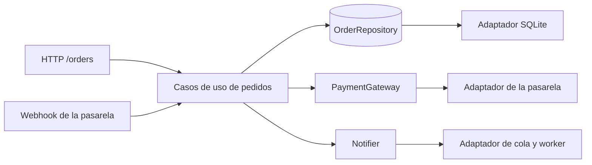

# Adicional 3: analisis de arquitectura VHS

Rama: `adicional-3-vhs`, a partir de la etiqueta `estado-final` de `main`. Es solo documentacion: no cambia el codigo. Las referencias de archivo y linea corresponden a `estado-final`.

## Alcance y nota sobre el termino VHS

No encontre una especificacion formal con el nombre "VHS". El material consultado trata las tres ideas por separado y de a pares: Vertical Slicing combinado con Hexagonal (Martinez, 2026), y la relacion de ambas con Screaming Architecture (Martin, 2011; Iglesias, 2024). En este documento uso VHS con este significado:

- **V y S:** el primer nivel del codigo se organiza por capacidad de negocio y "grita" de que trata el sistema (pedidos, clientes, productos), no por tipo tecnico.
- **H:** dentro de una capacidad, el nucleo de negocio se aisla mediante puertos (interfaces que el nucleo define) y adaptadores (implementaciones tecnicas que viven fuera de el).

Si el curso entrega una definicion propia de VHS, conviene contrastar esta con ella.

## Que aporta cada enfoque y como se relacionan

| Enfoque | Que aporta | Fuente |
| --- | --- | --- |
| Vertical Slice | Organiza por solicitud o funcionalidad, no por capas. Propone acoplar a lo largo del eje de cambio: poco acoplamiento entre slices y mucho dentro de cada una. Cada slice decide como resolverse, desde un transaction script hasta un modelo de dominio, y evoluciona por refactorizacion. Advierte que exige un equipo que reconozca code smells y sepa refactorizar | Bogard, 2018 |
| Screaming | Una arquitectura debe contar los casos de uso del sistema y no el framework. La web es un mecanismo de entrega y no debe dominar la estructura; las pruebas deberian correr sin servidor web ni base de datos | Martin, 2011 |
| Hexagonal (puertos y adaptadores) | Permite que una aplicacion sea manejada igual por usuarios, otros programas, pruebas o scripts, y que se desarrolle y pruebe aislada de la base de datos y de los dispositivos reales. Distingue puertos de entrada (que manejan a la aplicacion) y de salida (que la aplicacion maneja). Habla de dentro y fuera, no de capas, y no prescribe como estructurar el nucleo | Cockburn, segun Graca, iSAQB y Madewithlove |

Se relacionan porque responden preguntas distintas. Screaming responde que muestra la estructura; Vertical responde como se agrupa el codigo para que los cambios queden juntos; Hexagonal responde hacia donde apuntan las dependencias y donde se aisla lo tecnico. Zihler (2026) lo expresa como fuerzas independientes: los slices dan localidad por funcionalidad, las capas separan responsabilidades, y hexagonal u onion cuidan la direccion de las dependencias. Martinez (2026) los combina con una carpeta por funcionalidad y, dentro, dominio, aplicacion e infraestructura, con los puertos en el dominio. Iglesias (2024) ve tension en el medio: Vertical Slice no define con claridad que es una "feature", y los puertos de Hexagonal, entendidos como conversaciones, le parecen una forma mas natural de nombrarlas.

## Como se ve la arquitectura actual

### Lo que facilitaria adoptarla

- **Ya esta organizada por funcionalidad.** `main.py:23-25` incluye los routers `products`, `customers` y `orders`, y la carpeta `app/` ya dice de que trata el sistema. Es la parte V y S, casi hecha.
- **Hay un nucleo puro.** `PricingCalculator` (`app/pricing.py:1-17`) no depende de FastAPI ni de SQLite y se prueba sin mocks (`tests/test_pricing_calculator.py`).
- **La persistencia entra por un solo punto.** `Database` (`app/database.py:6-23`) concentra la conexion y las transacciones, y `create_app` (`main.py:13-31`) hace de raiz de composicion: crea la base y la deja en `application.state`, de donde la leen las rutas. Cambiar esa dependencia por una inyectada seria un paso corto.
- **La validacion de entrada ya esta en el borde.** Los modelos Pydantic (`app/orders.py:9-28`) cumplen el papel de adaptador de entrada.
- **Las pruebas no dependen de datos reales.** El fixture `client` crea una base temporal por prueba (`tests/conftest.py:8`).
- **Hay ejemplo de puerto de salida.** En la rama `adicional-2-cola-dlq`, `SimulatedChannel.deliver` en `app/notifications.py` ya es una frontera con una implementacion intercambiable, aunque nacio sin ese nombre.

### Lo que dificultaria adoptarla

- **Negocio, SQL y HTTP en la misma clase.** `OrderService` (`app/orders.py:31`) ejecuta SQL y lanza `HTTPException` desde sus metodos (`orders.py:40`, `42`, `45`, `51`, `119`, `127`). El nucleo conoce FastAPI, y la regla "solo se edita un pedido pendiente" vive entre consultas.
- **No hay servicio en clientes ni productos.** Las rutas contienen el SQL (`app/customers.py:19-28`, `app/products.py:18-24`), de modo que no existe una capa de aplicacion que aislar.
- **Los slices comparten tablas.** `orders` consulta `customers` (`orders.py:43`) y `products` (`orders.py:49`) y descuenta `products.stock` (`orders.py:123`). No hay una frontera entre modulos: una futura extraccion de productos arrastraria a pedidos.
- **Las excepciones de infraestructura suben hasta HTTP.** `sqlite3.IntegrityError` se traduce a `409` en las rutas (`products.py:61`, `customers.py:68`) y `sqlite3.OperationalError` a `503` en `main.py:27-29`. Cambiar de motor exigiria tocar la capa web.
- **El modelo es un diccionario.** Los pedidos viajan como `dict(row)` y el estado es una cadena revisada con `if` en cada metodo (`orders.py:41`, `118`, `142`, `152`). No hay una entidad con comportamiento que proteja las transiciones.
- **El nucleo no se prueba sin simular SQL.** `tests/test_pricing_unit.py:18-23` necesita un `MagicMock` de la conexion para ejercitar reglas de precio a traves de `OrderService`. Es la senal mas directa de que falta una frontera.

## Un escenario de crecimiento

La tienda incorpora **pagos con una pasarela externa**, **reembolsos** y **notificaciones por correo y mensajeria**, y la pasarela confirma los pagos con un **webhook**. Aparecen los casos de uso `PagarPedido`, `ReembolsarPedido` y `RegistrarPagoDesdeWebhook`, y el pedido gana estados (`pagado`, `reembolsado`). El mismo caso de uso se dispara ahora desde dos entradas, HTTP y webhook, y habla con dos sistemas externos que fallan y se reintentan. Ese es el caso donde las fronteras de Hexagonal rinden: varias entradas para una misma regla, integraciones que no deben filtrarse al nucleo, y pruebas que no deben exigir pasarela ni base de datos.



## Propuesta de organizacion para ese escenario

```
app/
  orders/                       # capacidad con frontera real: aqui si va H
    domain.py                   # Order, OrderLine, estados y reglas, sin FastAPI ni SQLite
    use_cases.py                # CrearPedido, Cotizar, Confirmar, Pagar, Reembolsar
    ports.py                    # OrderRepository, CustomerLookup, StockService, PaymentGateway, Notifier
    adapters/
      http.py                   # routers FastAPI y traduccion de errores de dominio a HTTP
      webhook.py                # segunda entrada hacia los mismos casos de uso
      sqlite_orders.py          # implementa OrderRepository
      payment_provider.py       # implementa PaymentGateway
      notifications.py          # implementa Notifier sobre la cola y el worker
  customers/                    # slice simple: CRUD con acceso directo
  products/                     # slice simple, ademas expone la reserva de stock
  pricing/                      # nucleo puro, ya existe
  shared/                       # Database y errores comunes
main.py                         # composicion: crea adaptadores y los inyecta
```

Solo `orders` recibe puertos, porque es donde hay fronteras reales (persistencia propia, stock de otro modulo, pasarela, notificaciones). `customers` y `products` siguen como slices con SQL directo mientras sean CRUD.

## Que se resuelve sin VHS

Varios de los problemas de arriba se corrigen con refactorizaciones mas simples, sin introducir puertos ni carpetas nuevas:

| Problema actual | Refactorizacion mas simple | Que aportaria VHS ademas |
| --- | --- | --- |
| `HTTPException` dentro de `OrderService` | Lanzar excepciones propias (`PedidoNoEncontrado`, `EstadoInvalido`) y traducirlas en el router | Nada: es un cambio local |
| `OrderService` hace de todo (Large Class, Long Method) | Extract Class (consultas de comandos) y Extract Method del acceso a datos | Una carpeta por capacidad para ubicar cada parte |
| Pruebas con `MagicMock` de la conexion | Probar con una base temporal, como ya hace el resto de la suite, o con `PricingCalculator` directo | Poder reemplazar la persistencia por un doble sin SQL |
| SQL repetido para leer un pedido con sus lineas | Extract Method a un helper de consulta | Un repositorio detras de un puerto |
| Excepciones de SQLite en las rutas | Una funcion de traduccion en un solo lugar | Que el nucleo ignore SQLite por completo |
| Estados como cadenas sueltas | Una enumeracion y un metodo de transicion | Una entidad del dominio con invariantes |

Lo que VHS agrega y las refactorizaciones simples no dan: sustituir la persistencia, la pasarela o el canal de notificacion sin tocar el nucleo; atender varias entradas con una sola implementacion de cada caso de uso; y probar el negocio sin base de datos, ni siquiera temporal.

## Conclusion

**No la adoptaria completa. La adoptaria de forma parcial y escalonada.**

1. **Ahora, a costo casi nulo (V y S).** Formalizar la organizacion por capacidad que el proyecto ya tiene, y aplicar las refactorizaciones simples de la tabla anterior, que son las que corrigen los problemas reales de hoy.
2. **Cuando llegue el escenario (H, solo en `orders`).** Introducir nucleo y puertos para pedidos cuando aparezcan las dos senales que lo justifican: un segundo punto de entrada para los mismos casos de uso y una integracion externa cuyo fallo no deba afectar al nucleo. Hasta entonces, un puerto con una sola implementacion es ceremonia (Zihler).
3. **No hacerlo en `customers` ni `products`.** Son CRUD: mas carpetas y mas interfaces solo aumentarian el codigo sin proteger ninguna regla.

**Beneficios:** pruebas del negocio sin infraestructura, cambios de proveedor o de motor sin tocar el nucleo, y una estructura que cuenta que hace el sistema.

**Costos:** mas archivos y mas indireccion para seguir una peticion; conversion entre el modelo de dominio y el de persistencia; el costo de aprender la convencion; y el riesgo, que advierten Martinez y Zihler, de pagar la estructura antes de necesitarla. El proyecto actual tiene unas 300 instrucciones: una arquitectura completa seria desproporcionada hoy. Ademas, Vertical Slice supone un equipo que sepa refactorizar, y el laboratorio ya documenta los smells y las tecnicas aplicadas, de modo que la ruta escalonada se apoya en habilidades que el trabajo ya ejercita.

## Fuentes

Lectura completa:

- Bogard, J. (2018). *Vertical Slice Architecture*. https://www.jimmybogard.com/vertical-slice-architecture/
- Martin, R. C. (2011). *Screaming Architecture*. https://blog.cleancoder.com/uncle-bob/2011/09/30/Screaming-Architecture.html
- Iglesias, F. (2024). *Vertical Slice Architecture*. https://franiglesias.github.io/vertical-slice-architecture/
- Martinez, C. (2026). *Implementing Hexagonal Architecture in React: A Complete Practical Guide*. https://dev.to/carlosgmdev/implementing-hexagonal-architecture-in-react-a-complete-practical-guide-2fj5
- Zihler, O. (2026). *Architecture Is an Escalation Path, Not a Starting Template*. https://codeartify.substack.com/p/architecture-as-an-escalation-path

Hexagonal, a traves de extractos de busqueda. No pude abrir el articulo original de Cockburn (2005, https://alistair.cockburn.us/hexagonal-architecture/), por lo que apoyo lo que atribuyo a el en estas fuentes secundarias:

- Graca, H. (2017). *Ports & Adapters Architecture*. https://herbertograca.com/2017/09/14/ports-adapters-architecture/
- iSAQB (2026). *SAG 2025 Keynote Alistair Cockburn: The Hexagonal, or Ports & Adapters Architecture*. https://conferences.isaqb.org/software-architecture-gathering/sag-2025-keynote-alistair-cockburn-the-hexagonal-or-ports-adapters-architecture/
- Madewithlove. *Hexagonal Architecture Demystified*. https://madewithlove.com/blog/hexagonal-architecture-demystified.md
- Wikipedia. *Hexagonal architecture (software)*. https://en.wikipedia.org/wiki/Hexagonal_architecture_(software)
